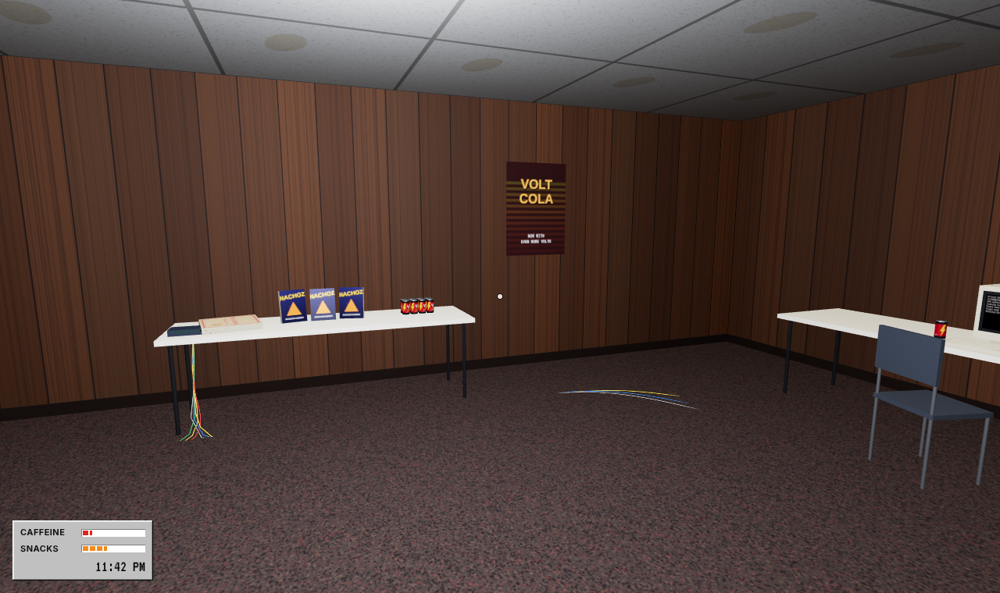
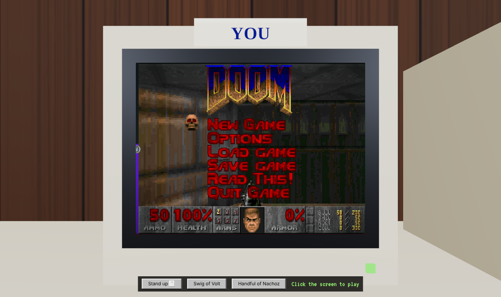

# LAN Party '98

Live at **https://lanparty1998.com**




A 3D basement LAN party in the browser. Walk around with everyone else who's online, crack a Volt Cola, eat Nachoz, grab a free PC and play DOOM, Quake, Hexen, Heretic or Descent on an emulated DOS box, then start a deathmatch with whoever else is sitting down.

## Playing

1. Enter a handle and walk in. Everyone on the site shares the same basement; add `?room=<name>` to the URL for a private room.
2. Walk up to any free PC (its screen says **FREE**) and press **E**. DOOM boots solo. The **Game** button on the seated bar reboots the PC into the next game.
3. To deathmatch: one seated player clicks **Host a deathmatch**, others sitting at PCs click **Join deathmatch** (up to 4), and the host clicks **Start**. Every PC in the match reboots into DOOM's `IPXSETUP` and finds the others over a virtual IPX network.
4. Standing up (backtick) leaves the deathmatch.

| Key | Action |
| --- | --- |
| W A S D + mouse | Walk and look |
| E | Sit at a PC · drink · eat |
| F | Open the case of the PC you're looking at |
| T | Chat |
| N | Noises on or off |
| I · M · H | Show or hide the IRC window · LANamp · Internet Explorer |
| Tab | Free the mouse for the taskbar, Start menu and windows (click the room to walk again) |
| ` (backtick) | Stand up from your PC |
| Esc | Release the mouse |

## How it fits together

- `js/room.js` builds the basement from primitives: folding tables, six beige PCs, CRTs, the hub and cat5 runs.
- `js/textures.js` draws every texture on canvas, including the idle and "someone's playing" screens.
- `js/avatars.js` draws the other players and moves them to wherever the server says they are.
- `js/net.js` talks to the room server over a WebSocket. If it can't connect, the game runs solo.
- `js/emulator.js` wraps js-dos. When you sit, the DOS canvas is laid exactly over your CRT's glass; standing pauses it.
- `js/desktop.js` is the desktop around the room: the taskbar, the Start menu and draggable windows. `js/apps.js` holds the programs that run in them, `js/icons.js` the 16x16 pixel icons.
- `js/app-browser.js` is Internet Explorer: a Win98-era web browser window with a menu bar, Back, Forward, Stop, Refresh, Home, an Address bar, a Links bar, an Explorer bar (Search, Favorites, History) and a status bar. `js/web-pages.js` is the site it shows, http://lanparty1998.com/ as a 1998 homepage (home, news, games, how to play, guestbook, links, Dazza's page, and the 404 and "page cannot be displayed" pages), and `js/web-news.js` is its news. Neither has DOM code in it; `node tools/web.test.mjs` checks the addresses, every page and link, the news and the search.
- `js/snapster.js` is Snapster's made-up network (bands, titles, users, search, transfers, library) with no DOM; `js/app-snapster.js` is its window. `tools/snapster.test.mjs` checks it.
- `js/minesweeper.js`, `js/calc.js`, `js/solitaire.js` and `js/ski.js` are the rules of Minesweeper, the Calculator, Solitaire and Downhill, with no DOM so they can be tested. `js/app-solitaire.js` and `js/app-ski.js` are their windows.
- `js/main.js` handles movement, interaction, seats, chat, the deathmatch flow and the caffeine/snack meters.
- `server/` is the room server: a Cloudflare Worker with one Durable Object per room. It tracks players, positions, seats, chat and the current deathmatch. It deploys to `room.lanparty1998.com`.
- `vendor/` holds pinned copies of Three.js r179 and js-dos 8.5.3.

### The night's logistics

`js/party.js` holds the state of the night (cash, discs, and the rest as it's added). It has no DOM code, so `node tools/party.test.mjs` tests it.

- **The CD burner.** PC-04 has the only CD-R drive and it writes at 2x: a 74 minute disc is a 37 minute write (about six real minutes; a game minute is ten real seconds). Walk up to the drive and press **E**. A blank costs $4, mates pay $10 for a MIX CD. Sit at PC-04 and play while it's writing and it makes a coaster.

- **The network.** You start on 10BASE2 coax: one cable runs under the tables and across the floor, with a T-connector at every tower. Every few minutes one works itself loose and the whole segment goes down (and so does your deathmatch). Look at the PC with the tilted T-connector, press **F** and re-seat it. Read the computer shop price list on the snack table and order an 8-port hub ($45); it arrives ten game minutes later and cat5 runs to the hub. Then ring Dazza (the wall phone): his dad works in IT for the government and will lend a 16-port switch, with an asset sticker on it, until 6:00 AM, when it goes back. A coax fault disconnects everyone at once, a hub or switch only the one PC.
- **File sharing.** Every PC starts with Windows file sharing broken: Network Neighborhood says "Unable to browse network". You are the one who has to go round and fix them. **F** at a PC and press Fix file sharing: it walks through Client for Microsoft Networks, IPX/SPX, File and Printer Sharing, the workgroup, a restart and the share. It takes about 19 seconds, it fails often (more on coax, less on a switch) with a proper Windows error, and you try again. Shares come undone by themselves every few minutes, and a blue screen takes one with it. Restarting PC-04 while it's burning makes a coaster. While two or more PCs are sharing, files go round, and the library on the HUD fills up much faster on a hub or switch.
- **The night.** The doors open at 7:30 PM and the room wants shooters: the HUD says DOOM until midnight. At midnight somebody kicks off a StarCraft game, announced in chat, and every free PC with at least 32MB shows it running. Free PCs with less show a DOS "Not enough memory" error, so the RAM has to land before midnight. StarCraft itself isn't bundled (commercial game data is for you to supply, like the others), so sitting down still runs DOOM.
- **RAM from Singapore.** Every PC starts on 16MB. Macca (by the snack table) is off to Singapore for work, where a 16MB SIMM is $35 instead of the shop's $75. Give him the cash first; he disappears for about fifteen real minutes and comes back with the sticks. **F** at a PC fits one (up to 64MB). The BIOS screen on that PC counts the new memory.
- **Overclocking and the fan.** Press **F** at a PC and move the jumpers: 100MHz bus, or 112MHz with extra volts. It runs hotter, and the case temperature shows in that dialog. The pedestal fan in the room sweeps between the two rows and keeps overclocked boxes alive; press **E** at it to turn it on or off. If it goes off (somebody kicks the plug, or you trip over its lead) the overclocked PCs blue screen, the heavy overclock in about two minutes. A blue screen on PC-04 mid-write ruins the disc. Press any key at the blue screen to reboot, with the case still hot. Overclocking is a risk and a boast, not a frame rate boost: DOSBox already runs DOOM flat out.
- **Trip hazards.** The cat5 leads (and the coax) lie across the floor. The cables are gaffer-taped, so most crossings are fine, but each time you step over one it is a roll (about 30%, worse after a few cans of Volt). Trip and you stumble, and the lead comes out of the back of its PC. Press **F** at that PC to plug it back in, or watch where you walk.
- **The door.** There's a door in the back wall, with a landing and a staircase up to the rest of the house. **E** opens and closes it, and you can step onto the landing when it's open. Mum is upstairs and says so. Other players see you stop at the doorway.
- **Posters.** Besides the LAN party flyers there's a DUKE NUKEM 3D poster, a Y2K countdown, a 56K modem poster and an invented adventure game with a pixel treasure chest. Duke Nukem is named in text only: there are no characters or box art, and the game isn't bundled or playable here. Six more are invented, drawn in the spirit of the era: three game boxes (IRON HYMN, RICO RAMPAGE 3D, VOID HARVEST) and three film one-sheets (DEEP CORE, CHROME SHIFT 2, BUS STOP BANDITS). Titles, characters and art are all made up, not copies of any real cover or poster (`gamePoster` and `moviePoster` in `js/textures.js`).
- **Chatter.** The regulars talk to each other: a Win98 speech bubble pops up over their heads (and over any other player when they type) and what they say is mostly teenage-boy stuff: burps, farts, your mum, whose socks smell. Lines tagged with a noise play it (a burp, a fart, a snicker, a snort, all synthesised in `js/sfx.js`), pitched per person (`js/voices.js`). The rest is text only: nothing is spoken aloud. The noises get quieter with distance, and **N** turns them off. The scenes live in `SCENES` in `js/irc.js`.
- **The desktop.** A Win95-style taskbar runs along the bottom with a **Start** button, a button for every open window, a speaker (shows or hides LANamp) and the party clock. IRC and LANamp are real windows: drag them by the title bar, minimise them to the taskbar, close them, and open them again from **Start** > Programs or with **I** and **M**. The mouse is captured while you walk, so press **Tab** (or Esc) to free it, click on the taskbar, and click the room to walk again. The Start menu has Programs (Accessories: Calculator, MS-DOS Prompt, Notepad, Paint; Games: Minesweeper, Solitaire, Downhill; System Tools: Disk Defragmenter; mIRC; LANamp), Documents (empty), Help, Run... and Shut Down.... Everything in it works: Minesweeper has the three classic levels and chording, Solitaire is Klondike (draw one or three, drag or click, double click to a foundation, undo), Downhill is an endless ski run with trees, ramps, gates and a bear after 2000 m (arrows, F for speed, P to pause), the Calculator has a memory, the MS-DOS Prompt has `DIR`, `CD`, `TYPE`, `PING` and friends, Paint has a pencil, brush, eraser and fill, and Disk Defragmenter takes about thirty seconds. Snapster is a file-sharing client (Start > Programs > Snapster, or Run... `snapster`): search a crowd of 26 made-up regulars for MP3s by 36 made-up bands, sort by any column, double click to get a song, and watch the transfer wait in line and crawl in at the speed of your chosen modem (File > Disconnect and Options > My connection both work). Finished songs land in the Library tab for as long as the page is open. Nothing is downloaded: the files, bands, titles and users are all invented. Run... knows the program names, and Shut Down... turns the computer off (click to switch it back on), restarts it, or restarts it in MS-DOS mode. Windows opened from the menu are thrown away when you close them. `node tools/minesweeper.test.mjs`, `tools/solitaire.test.mjs`, `tools/ski.test.mjs`, `tools/calc.test.mjs` and `tools/icons.test.mjs` check the logic and the icons.
- **Internet Explorer.** It is open on the news page when you walk in (`desktop.startWith` in `js/apps.js`). Start > Programs > Internet Explorer, Start > Favorites, **H**, or type an address into Run... It opens on `http://lanparty1998.com/`, the party's own site: the schedule, **What's New** (every new feature and bug fix, filterable with `news.htm?show=new` or `?show=fix`), **Games** (every game on the PCs, built from `js/games.js`, plus Minesweeper, Solitaire, Downhill, the midnight StarCraft and what is only a poster), **How to Play**, a **Guestbook** you can sign (kept until you close the window), **Links** and Dazza's cheat-code page. Every other address gets "The page cannot be displayed", as on a basement hub in 1998. Back, Forward, Stop (Esc), Refresh (F5), Home (Alt+Home), Ctrl+L for the Address bar, a Search, Favorites and History bar, View > Source (in Notepad), Work Offline, and a hit counter that goes up with each visit. Pages load in a few slow steps with the throbber turning; reduced motion loads them at once. To add news, add an entry to the top of `NEWS` in `js/web-news.js`.
- **#lanparty98.** A mIRC-style window (starts top right, **I** toggles it) where the regulars tell dumb jokes, roast each other's frag counts, hit back and cackle (the window starts full, mid-argument), and pile on when something happens: a blue screen, a tripped cable, midnight, someone walking in. Chat (**T**) shows up there too and works offline. `js/irc.js` holds the banter, tested by `node tools/irc.test.mjs`.
- **The crowd.** Everyone is dressed as a 90s teen: goths in trench coats, surfers, hip hop kids, ravers, grunge kids and nerds. A look is picked from each player's id, so it is the same on everyone's screen: height, build, hair, facial hair, glasses, hats, chains and shoes all vary. Macca and four regulars from the IRC channel (xX_Ghoul_Xx, PhatBass, K-Rad, n00bslayer) are sat down playing: K-Rad and n00bslayer at a pair of PCs on a table against the right wall, xX_Ghoul_Xx at one in the front-left corner, Macca and PhatBass on the couch with the pads. Nobody dances (that wasn't a thing at a 98 LAN). Those extra PCs are scenery and can't be used; only the six real ones are for visitors. Seated avatars, yours included from other players' screens, type and mouse with their hands, or hold a pad on the couch, and the regulars lean in when a fight kicks off.
- **LANamp.** A Winamp-style player (a desktop window, starts bottom right; **M** shows or hides it; **Z X C V B** are previous, play, pause, stop, next) plays eight original tracks, two each of hip hop, drum and bass, EDM and rock, synthesised live in the browser from patterns in `js/music.js`: no samples and no audio files. The spectrum and the clock are live. **Your own MP3s:** **ADD DIR** picks a folder and LANamp scans it and every folder below it for `.mp3` files, adds them to the playlist after the built-in tape, and reads the ID3 tags (title, artist, album) in the background, falling back to the file name. Files are played straight from your drive and never uploaded. Chrome and Edge remember the folder (**RESCAN** asks permission again each visit, **CLR** forgets it); Firefox and Safari get a plain folder chooser, phones a file chooser, and you can also drop files or folders on the window. The code is in `js/library.js` (scanning and tags) and `js/lanamp.js`. `node tools/music.test.mjs` checks the track data, the tag parsing and the player's file handling.
- **The lounge.** A plaid couch faces a big CRT TV against the right wall, with a four-player console on the shelf under it and four wired pads (three on the cushions, one dropped on the carpet). The TV runs a looping four-player brawl, and the coffee table in between is covered in Volt cans, a half-eaten pizza, a bowl of Nachoz, an open bag of Cheez Curlz, CDs, floppies and a jewel case. A teal bean bag is slumped in the back-left corner. Cans and snacks work with **E** like the rest. Green Citrus Zap two-litres and stacks of red party cups sit on the snack table and on the carpet by the couch; press **E** to pour one. All parody: no real console or game.
- **Pizza.** The wall phone has a pizza menu: a large pepperoni is $16, eight slices, and turns up about 25 game minutes later, in a box on one of the tables. A few half-eaten boxes are already lying around. **E** on a box eats a slice (the snack meter goes up and you see the slice in your hand), and the regulars eat from the boxes too, with an arm-to-mouth animation and three bites. Other players' avatars don't eat (the server doesn't relay it).
- **Disks everywhere.** Floppies sit on top of the PC cases and beside the keyboards, with CDs on the tables, the carpet, a keyboard and a chair, and a CD tray left open on some towers. There are floppy cases, a flip-top tub, a CD spindle, jewel cases and a ten-pack of blanks. It's all decoration, drawn in `buildMedia()` in `js/room.js`.
- **The man on the ceiling.** DUCTAPE is taped to the ceiling duct near the front wall, holding a pole and a slice of pizza. **E** to talk to him.

### Deathmatch networking

Game traffic doesn't go through the room server. js-dos emulates IPX over WebRTC: the host's DOSBox runs an IPX tunnelling server, the room server hands its network peer id to the other players, and their DOSBoxes connect to it peer to peer. Signalling uses js-dos's public peer server (`net.dos.zone`), and NAT traversal uses public STUN only. Players behind strict (symmetric) NATs may not be able to connect until a TURN server is added.

## Run it locally

```sh
# room server (http://127.0.0.1:8787)
cd server && npm install && npx wrangler dev

# the site, from the repo root
python3 -m http.server 8000
# open http://localhost:8000 — on localhost the page uses the local room server
```

`?server=wss://…` points the page at any room server.

## Game data

| Game | Year | Network | How a deathmatch starts |
| --- | --- | --- | --- |
| DOOM 1.9 | 1994 | IPX, up to 4 here | `IPXSETUP -nodes N -deathmatch`, automatic |
| Heretic 1.3 | 1995 | IPX | same |
| Hexen (4 level demo) | 1995 | IPX | same |
| Descent 1.0 | 1995 | IPX | in the game's own menu: Multiplayer, Start/Join a network game |
| Quake 1.06 | 1996 | IPX | in the game's own menu: Multiplayer, New Game / Join a Game |

Each `bundles/<game>-shareware.zip` is that game's shareware release as id, Raven or Parallax handed it round (Quake's installer wrapper unpacked, the data untouched). `bundles/conf-*.jsdos` are tiny js-dos bundles holding only a `dosbox.conf`; rebuild them with `python3 tools/make-confs.py`. Where each file came from is in `bundles/SOURCES.md`.

Only redistributable data goes in this repo: shareware releases whose licence says to pass them on. Commercial game files (full DOOM, DOOM II, the registered Quake episodes, StarCraft, etc.) must be supplied by the player.

## Next

- TURN server for players behind strict NATs.
- Quake, Quake II and Red Alert/C&C via OpenRA.
- **Cheez Curlz.** A second snack, a green bag of orange curls, on PC-01, PC-05, the snack table and the coffee table. **E** works on them like Nachoz, and the regulars eat them too.
- More rooms, more snacks.

## Design system

All UI, textures, icons and social images follow [`STYLEGUIDE.md`](STYLEGUIDE.md). Tokens live in `css/tokens.css` (mirrored to `design/tokens.json`), and a live reference is at [/styleguide.html](https://lanparty1998.com/styleguide.html).

```sh
python3 scripts/build-tokens.py    # tokens.css -> design/tokens.json
python3 scripts/render-social.py   # og-image, twitter-card and icons from their sources
```

## Contact

contact@lanparty1998.com

## Licences

Three.js is MIT (`vendor/three/LICENSE`). js-dos is GPL-2.0. DOOM shareware © id Software, distributed under its shareware terms. VT323 is SIL OFL 1.1 (`fonts/VT323-OFL.txt`). "Volt Cola", "Nachoz", "Cheez Curlz" and "Citrus Zap" are parody brands.

## Analytics events (GA4 `G-P6RQJ9BSJ1`)

Sent from `js/analytics.js`:

| Event | Params |
| --- | --- |
| `enter_party` | — |
| `drink_cola` | `cans_total`, `caffeine_level` |
| `caffeine_overload` | `cans_total` (caffeine above 85) |
| `eat_snack` | `handfuls_total`, `snack_level` |
| `sit_down` | `station` |
| `game_start` | `game_name`, `games_total` (once per emulator boot) |
| `stand_up` | `game_name`, `play_seconds` |
| `trip_cable` | `cable` (`cat5` or `coax`), `trips_total` |
| `party_summary` | `cans_total`, `handfuls_total`, `games_total`, `play_seconds` (on tab close) |

### Inviting people

`tools/remind.mjs` emails everyone on a list and tells them to come and play. Copy `tools/invitees.example.csv` to `tools/invitees.csv` (gitignored: it holds real addresses) and add `email,name` lines.

```
node tools/remind.mjs                          # dry run: lists who would get it, sends nothing
node tools/remind.mjs --send                   # sends (needs RESEND_API_KEY and REMIND_FROM)
node tools/remind.mjs --room friday --when "Sat 7:30 PM"
```

The email is plain text, links to https://lanparty1998.com (or a private `?room=`), and tells people to reply STOP to be dropped from the list. `node tools/remind.test.mjs` checks the list parsing and the message.
